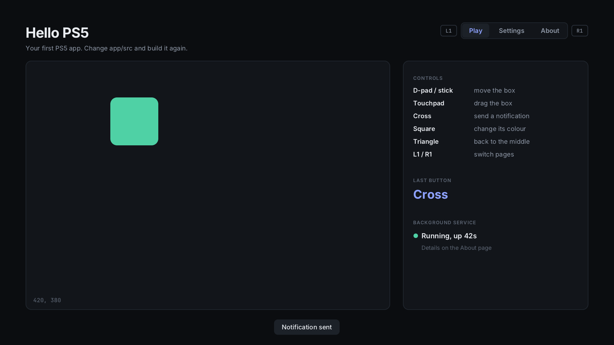

# PS5 Homebrew Starter

Everything you need to make your first PS5: payload (a program that
runs in the background) and an app (a title on the home screen), with a guide
that takes you from an empty PC to both running on your console, and on to
sharing them.

Every piece here builds and runs. The patterns come from
[Breeze](https://github.com/MiladRTX/Breeze), a PS5 fan control app built the
same way and tested on real hardware.

## What you'll make

| | What it is | Where it runs |
| --- | --- | --- |
| [`payload/hello`](payload/hello) | Twenty lines of C that show a notification | Loaded once, then it exits |
| [`payload/service`](payload/service) | A background service with a status page you open on your phone. It runs as a single copy, logs, survives rest mode and stops cleanly | Keeps running in the background |
| [`app/sim`](app/sim) | **The PC simulator**: Hello PS5 live in a window on your PC, with the keyboard, mouse or a controller, and the service running too | On your PC |
| [`app`](app) | **Hello PS5**, a home screen app with four pages: drawing, text, the DualSense, the touchpad, a settings menu, a list that scrolls, the on-screen keyboard, pictures, sound, notifications, saved settings. It starts the service, shows its status, and replaces it with a newer one after an update | On the TV, from the home screen |



## Before you start

- A PS5 that already runs homebrew, with these running (see below)
- A PC with Windows 10 or 11 (with WSL) or Linux
- Some C or C++. You don't need to know the PS5: that's what the guide is for.

### Check your console first

| Project | What it's for here |
| --- | --- |
| [elfldr](https://github.com/ps5-payload-dev/elfldr) by ps5-payload-dev | starts payloads you send it (port 9021) |
| [Payload Manager](https://github.com/itsPLK/ps5-payload-manager) by itsPLK | starts payloads from a web page; easier than elfldr alone |
| [ShadowMountPlus](https://github.com/drakmor/ShadowMountPlus) by drakmor | puts apps from `/data/homebrew` on the home screen |
| [ftpsrv](https://github.com/ps5-payload-dev/ftpsrv) by ps5-payload-dev, or another FTP server | copies files between your PC and the console |

Set these up with their own guides. This guide starts once they're running,
and doesn't cover getting a console to run homebrew in the first place.

A one-minute check that you're ready:

- [ ] Payload Manager's page opens in a browser (usually `http://<PS5 IP>:8084`)
- [ ] Your FTP client connects to the console (ftpsrv uses port 2121)
- [ ] `shadowmountplus.elf` is in Payload Manager's process list

## Quick start

In WSL (or Linux):

```bash
git clone https://github.com/MiladRTX/ps5-homebrew-starter.git
cd ps5-homebrew-starter
tools/setup.sh                      # compilers + the PS5 payload SDK, once
make -C payload/hello               # payload/hello/hello.elf
app/build.sh                        # build/app/PPSA99901 and its ZIP
app/sim/run.sh                      # the app live in a window on your PC, no console needed
```

Then load `hello.elf` with Payload Manager, and copy `build/app/PPSA99901` to
`/data/homebrew/` on the console. The chapters below explain every step.

To make it yours, run `tools/new-app.py "My App" PPSA<five digits>` with a
title ID nobody else uses (chapter 11). The app folder is then
`build/app/<your title ID>`.


## The guide

Read it in order the first time. Each chapter ends with something working.

1. [Set up your PC](docs/01-setup.md)
2. [Your first payload](docs/02-first-payload.md)
3. [A real background payload](docs/03-background-payload.md)
4. [Surviving rest mode](docs/04-surviving-rest-mode.md)
5. [Your first app](docs/05-first-app.md)
6. [App basics: drawing, input, files](docs/06-app-basics.md)
7. [Menus and pages](docs/07-menus-and-pages.md)
8. [Lists, pictures, the keyboard and sound](docs/08-lists-images-keyboard-sound.md)
9. [App and payload together](docs/09-app-and-payload.md)
10. [Testing on your PC](docs/10-pc-preview.md)
11. [Make it yours](docs/11-make-it-yours.md)
12. [Share it](docs/12-share-it.md)
13. [Troubleshooting](docs/13-troubleshooting.md)

## Layout

```
tools/setup.sh        installs the compilers and the payload SDK
tools/new-app.py      gives the app your name and title ID everywhere
payload/hello/        your first payload
payload/service/      the background service
app/src/              Hello PS5's code: hello.cpp runs it, page_*.cpp are its pages
app/sce_sys/          the app's title files: param.json, icon0.png
app/fonts/            fonts the app draws with
app/assets/           files the app carries: the controller button icons, and yours
app/stubs/            link-only stubs for system functions the SDK lacks
app/sim/              the PC simulator: the app live in a window
app/preview/          the PC preview: pictures of chosen screens
app/build.sh          builds the app (and the service it carries)
kit/                  ps5-native-app-boilerplate by BlackBearReloaded, which the app builds with
docs/                 the guide
```

## Credits and licenses

- The app builds on [ps5-native-app-boilerplate](https://github.com/blackbearreloaded/ps5-native-app-boilerplate)
  by **BlackBearReloaded** (GPL-3.0-or-later). It's included in [`kit/`](kit) as it
  is at commit `44ae1da`, with its own README and license; only its demo app's
  artwork and music are left out, since the starter has its own. One addition
  (2026-10-20, in `kit/Makefile` and `kit/tools/build.sh`, each marked) comes
  from the kit's later version: `APP_IMPORT_STUBS`, for system functions the
  SDK has no stubs for.
- The on-screen keyboard and the sound output follow BlackBearReloaded's code
  in ProsperoStore (GPL-3.0-or-later).
- Payloads build with the [PS5 payload SDK](https://github.com/ps5-payload-dev/sdk) by John Törnblom.
- The app's renderer comes from [Breeze](https://github.com/MiladRTX/Breeze) by
  Milad, which built it on ps5-native-app-boilerplate's demo renderer by
  BlackBearReloaded. The fonts handling and controller code come from Breeze too.
- Fonts: [Inter](https://rsms.me/inter/) and [JetBrains Mono](https://www.jetbrains.com/lp/mono/),
  SIL Open Font License (licenses in `app/fonts/`).
- Text and pictures: [stb_truetype and stb_image](https://github.com/nothings/stb) by Sean Barrett (public domain / MIT).
- Button icons: [PS4 Buttons](https://arks.itch.io/ps4-buttons) by **Arks** (@ScissorMarks),
  [CC BY 4.0](https://creativecommons.org/licenses/by/4.0/), resized
  (`app/assets/buttons/CREDITS.txt`).

This starter is GPL-3.0 (see [LICENSE](LICENSE)), like the boilerplate it
builds on. An app made from it is GPL-3.0 too: share its source when you share it.
