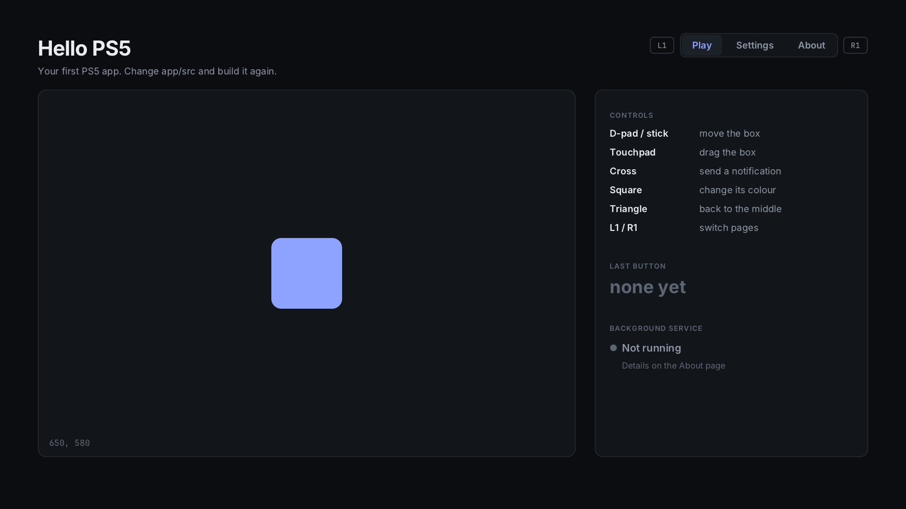

# 5. Your first app

A payload has no face. An **app** is a title on the home screen: it has an
icon, it opens full screen, and the DualSense controls it. This chapter builds
**Hello PS5** and puts it on your console. Chapter 6 then goes through its code.



## What an app is made of

An app is a folder named after its **title ID** (here `PPSA99901`):

```
PPSA99901/
  eboot.bin              the program: your code, compiled
  sce_sys/param.json     its name, title ID and version
  sce_sys/icon0.png      the home screen tile, 512x512
  sce_module/libc.prx    the C library the program runs on (the kit adds it)
  assets/                your own files: fonts, images, service.elf
```

On the console, the app sees its own folder as `/app0`, read-only: the fonts
are at `/app0/assets/fonts/`.

**ShadowMountPlus** is what puts it on the home screen. It looks in
`/data/homebrew/` every 15 seconds or so, and registers any app folder it
finds there.

## Build it

```bash
app/build.sh
```

The app is built with **ps5-native-app-boilerplate** by BlackBearReloaded,
the kit that turns C++ into a PS5 app. It's included in this starter, in
[`kit/`](../kit). The first build takes a few minutes, because the kit builds
its tools and zlib first; later builds take seconds.

```
==> [app] Compiling, linking, signing, and assembling the app folder
...
Build complete.
App folder: /home/you/.ps5-starter/kit-work/dist/PPSA99901
Folder ZIP: /home/you/.ps5-starter/kit-work/dist/PPSA99901.zip

App folder: build/app/PPSA99901
ZIP:        build/app/PPSA99901.zip
```

The first two paths are the kit's own work copy; use the last two, in `build/app/`.

What `app/build.sh` did, in order:

1. built `payload/service/service.elf`, because the app carries it (chapter 9)
2. copied `kit/` to `~/.ps5-starter/kit-work` (again only when `kit/` changed)
3. copied `app/src`, `app/sce_sys`, the fonts and `service.elf` next to the kit
4. checked the title files (the icon must be a 512x512 PNG, and so on)
5. had the kit compile, link and assemble the folder
6. copied the result to `build/app/`

The kit only takes paths without spaces, which is why it builds in your home
folder and not in this one.

## Put it on the console

Copy the whole `build/app/PPSA99901` folder into `/data/homebrew/` on the
console with your FTP client (in WinSCP or FileZilla, drag the folder across;
`explorer.exe build/app` opens it on the Windows side), so you end up with
`/data/homebrew/PPSA99901/eboot.bin` and the rest.

Or let the build do it over FTP:

```bash
app/build.sh deploy 192.168.0.10      # your PS5's address
```

That uses FTP port 2121. If your FTP server uses another port, add
`FTP_PORT=<port>` in front of the command.

Wait about 15 seconds: **Hello PS5** appears on the home screen with the "Hi"
icon. Open it.

## Try it

- **D-pad or left stick**: move the box
- **Touchpad**: the box follows your finger
- **Cross**: a notification pops up
- **Square**: the box changes colour
- **Triangle**: the box goes back to the middle
- **L1 / R1**: switch pages. **Notes** is a list you write with the PS5's
  keyboard (Triangle). **Settings** is a menu: box size, move speed, colour,
  sound. **About** shows the background service in detail, and the app's icon.

The panel on the right shows the last button you pressed, and the
**background service**: the app starts `service.elf` the first time you open
it, and shows whether it's running and for how long. The About page has the
rest, the CPU temperature included (chapter 9).

Close the app (PS button, then close it on the card) and open it again: the box
is where you left it, because the app saved its position (chapter 6).

## Changing it

The loop is: **edit, build, copy, open**.

1. Change something small in `app/src/hello.cpp`, like the title text.
2. `app/build.sh`
3. **Close the app on the console first.** Copying over an app that's open can
   leave you with a mix of old and new files.
4. Copy the folder again (or `app/build.sh deploy <IP>`), and open the app.

Chapter 10 shows how to see your changes on your PC first, without a console.

## Good to know

- **While an app is open, the PS5 treats it like a game.** For example, the
  fan's minimum speed is the in-game one. That's normal.
- **An app is closed when a game starts**, and when you close it yourself.
  Anything that has to keep running belongs in a payload (chapter 9).
- **Don't use the starter's title ID for your own app.** Chapter 11 explains
  how to pick your own before you share anything.

Next: [App basics: drawing, input, files](06-app-basics.md)
