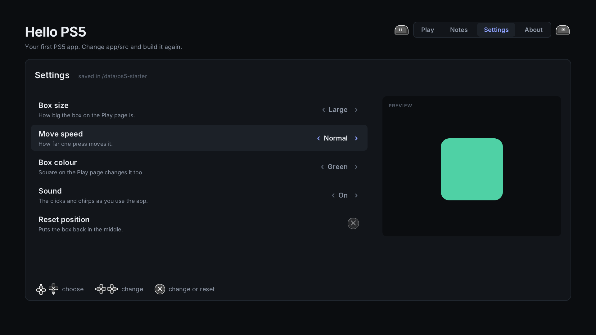

# 7. Menus and pages

One screen goes a long way, but a real app soon needs more: a settings menu,
an about page, maybe a list of things. Hello PS5 has four pages, **Play**,
**Notes**, **Settings** and **About**, switched with **L1** and **R1**. This
chapter shows how that's built, and how to add your own page or setting.
(Notes, a list with the on-screen keyboard, is chapter 8's.)



## How the app is split

| File | What's in it |
| --- | --- |
| [`hello.cpp`](../app/src/hello.cpp) | runs the app: the page table, the tab bar, saving, the service |
| [`page_play.cpp`](../app/src/page_play.cpp) | the Play page: the box, the controls |
| [`page_notes.cpp`](../app/src/page_notes.cpp) | the Notes page: a list that scrolls (chapter 8) |
| [`page_settings.cpp`](../app/src/page_settings.cpp) | the Settings page: a menu |
| [`page_about.cpp`](../app/src/page_about.cpp) | the About page: the service's details, the app's icon |
| [`pages.hpp`](../app/src/pages.hpp) | the pages' functions, declared for `hello.cpp` |
| [`hello.hpp`](../app/src/hello.hpp) | the state and the helpers every page can use |

Each page works like the app as a whole (chapter 6): an **update** function
for its buttons and a **draw** function for its look.

```cpp
bool settings_update(unsigned pressed) noexcept;
void settings_draw(screen::Canvas &c) noexcept;
```

## The page table

`hello.cpp` keeps the pages in one table, in tab order:

```cpp
} pages[page_count] = {
    {"Play", play_update, play_draw},
    {"Notes", notes_update, notes_draw},
    {"Settings", settings_update, settings_draw},
    {"About", about_update, about_draw},
};
```

The app's own `update` and `draw` just call the current page's:

```cpp
if (pressed & (pad::l1 | pad::r1)) {
    s.page = ...;                       // the next or previous page
    pressed &= ~(pad::l1 | pad::r1);    // L1 and R1 are the tab bar's
}
pages[static_cast<int>(s.page)].update(pressed);
```

L1 and R1 are taken out before the page sees the buttons, so no page can
accidentally react to them. Everything else, like the service check and
saving, keeps running whatever page is open.

`draw_tabs()` draws the tab bar from the same table, so the tabs always match
the pages.

## Adding a page

Say you want a **Stats** page:

1. Add `stats` to `enum class Page` in `hello.hpp`, and raise `page_count` to 5.
2. Write `page_stats.cpp` with `stats_update` and `stats_draw`, and declare them in `pages.hpp`.
3. Add `{"Stats", stats_update, stats_draw},` to the table in `hello.cpp`.
4. Add `page_stats` to the file list in `app/preview/run.sh`, and a shot of it
   in `preview.cpp`.

That's all. The tab bar, L1/R1 and the frame loop already handle it.

## A menu: the Settings page

A menu is a list of rows with one of them highlighted. The Settings page's rows
come from a table too:

```cpp
table[0] = {"Box size", &s.size, size_count, size_names, "How big the box on the Play page is."};
table[1] = {"Move speed", &s.speed, speed_count, speed_names, "How far one press moves it."};
table[2] = {"Box colour", &s.colour, colour_count, colour_names, "Square on the Play page changes it too."};
table[3] = {"Sound", &s.sound, 2, sound_names, "The clicks and chirps as you use the app."};
table[4] = {"Reset position", nullptr, 0, nullptr, "Puts the box back in the middle."};
```

A row with a `value` is a **choice**: it points at the setting it changes, and
lists the choices' names. A row without one is an **action**.

The buttons:

```cpp
if ((pressed & pad::up) && s.menu_selected > 0)       --s.menu_selected;
if ((pressed & pad::down) && s.menu_selected + 1 < row_count) ++s.menu_selected;
if (row.value && (pressed & pad::left))                step_choice(row, -1);
if (row.value && (pressed & (pad::right | pad::cross))) step_choice(row, +1);
if (!row.value && (pressed & pad::cross))              /* run the action */
```

- **Up and down** move the highlight, and stop at the ends instead of jumping
  round. That's easier to keep track of on a TV.
- **Left and right** step through a choice, going round at the ends: after
  Large comes Small.
- **Cross** steps a choice forward, or runs an action.

`step_choice()` changes the setting, applies it (the Sound row turns the
sound on or off right away) and calls `changed()`, which saves it a second
later. That's the same save as the box's position, in
`/data/ps5-starter/hello-app.txt`.

The drawing follows the same table: the label and its help line on the left,
the value on the right between `‹` and `›`, and a highlight behind the
selected row. The preview on the right draws the box from the current
settings, so a change shows at once.

## Adding a setting

Say you want a **Box shape** setting, square or round:

1. Add `int shape;` to `State` in `hello.hpp`, and `constexpr int shape_count = 2;`.
2. In `page_settings.cpp`, add the names, `{"Square", "Round"}`, and a line
   in the table. Raise `row_count`.
3. Save and load it: add it to `save()` and `load()` in `hello.cpp`. Check
   the loaded value is in range, like the others.
4. Use it: in `play_draw()`, draw a `c.circle(...)` when it's round.

## Good menu habits

- **Always one row highlighted**, and the selection kept when you leave the
  page and come back.
- **A line saying what the buttons do**, at the bottom, with the controller's
  own symbols (`buttons::hints()`, chapter 8). People don't guess controls on
  a TV.
- **Nothing destructive on a single press.** Resetting the box is harmless.
  Deleting something isn't: ask for a second press first. The Notes page does
  this ("Press Square again to delete").
- **Show the effect right away.** The preview box is there so people don't
  have to switch pages to see what they changed.

Next: [Lists, pictures, the keyboard and sound](08-lists-images-keyboard-sound.md)
