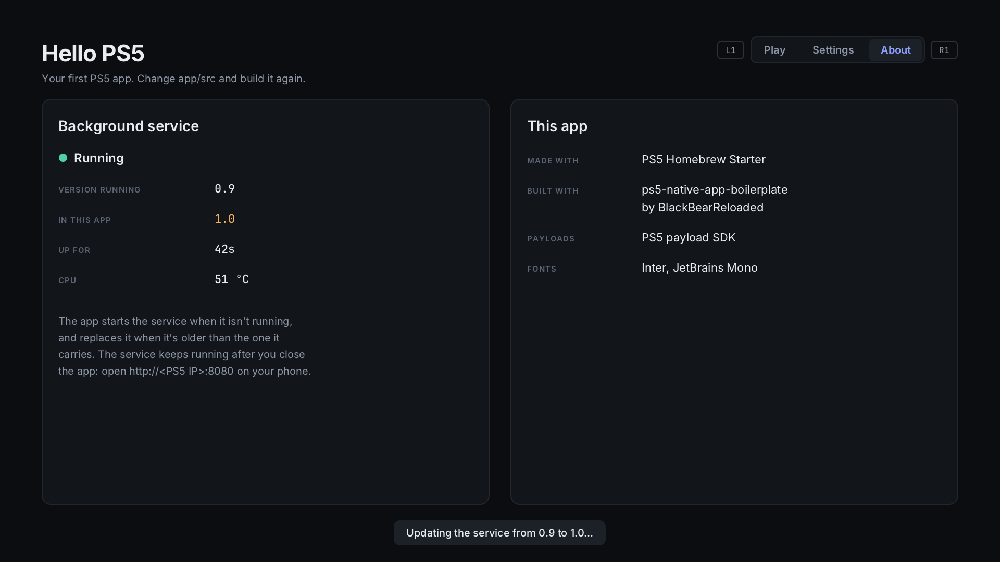

# 8. App and payload together

Apps and payloads are good at different things:

| | App | Payload |
| --- | --- | --- |
| On the TV, with the controller | yes | no |
| Keeps running when you leave it, or a game starts | no | yes |

So a lot of real homebrew is both: a **payload** that does the work in the
background, and an **app** that shows it and lets you change it. Breeze works
this way: the payload steers the fan while you play, and the app is the
screen you set it up on.

Hello PS5 does the same with `service.elf`, in three steps.

## 1. The app carries the payload

`app/build.sh` copies `service.elf` into the app's `assets/` folder, so it's
inside the app on the console:

```
/app0/assets/service.elf
```

One install gives the user both, always in matching versions.

## 2. Is it running? Ask it

The service serves `/status` on port 8080. The app asks on `127.0.0.1`, which
always means *this console*, so there's no address to look up:

```cpp
const int status = link::http_get(service_port, "/status", body, sizeof body);
s.service_up = status == 200;
if (s.service_up) {
    s.service_uptime_s = link::json_number(body, "uptime", -1);
    ...
}
```

`http_get` ([`link.cpp`](../app/src/link.cpp)) connects, sends a plain HTTP
request, and reads the answer, with a 1-second timeout. No answer within a
second means not running, and the frame loop never stalls for longer.

HTTP isn't the only option, but it's a good default: you can test the same
`/status` from a browser on your phone, and the payload doesn't care who's asking.

## 3. Not running? Start it

```cpp
if (!s.service_start_tried) {
    s.service_start_tried = true;
    const int r = link::start_payload(service_elf);
    ...
}
```

`start_payload` reads `/app0/assets/service.elf` and sends it to the ELF loader
on `127.0.0.1:9021`, exactly what you did by hand in chapter 2. The loader
starts it, the service opens its page, and two seconds later the app's next
check finds it.

The app tries **once per launch**. If the service crashes on start, trying
again every two seconds would just crash it again, forever. Once is enough to
cover "not started yet". The message on screen says what went wrong if it fails:

| Message | Meaning |
| --- | --- |
| *service.elf is missing from the app* | the build didn't include it |
| *No ELF loader on port 9021* | nothing listens on 9021, e.g. after rest mode (chapter 4) |

## 4. Older? Replace it

When someone updates the app, the **old** service is probably still running:
it doesn't know the app changed. Unless the app does something, they keep
the old service until the console restarts.



**One version, in one place.**
[`payload/service/service_version.h`](../payload/service/service_version.h):

```c
#define SERVICE_VERSION "1.0"
```

The service reports it on `/status` (`"version":"1.0"`), and the app is built
with the same file, so the app knows which version it carries. Raise it
whenever you change the service.

**The app compares, and replaces an older one:**

```cpp
link::json_text(body, "version", s.service_version, sizeof s.service_version);
if (!s.service_update_tried &&
    link::compare_versions(s.service_version, SERVICE_VERSION) < 0) {
    s.service_update_tried = true;
    link::start_payload(service_elf);   // "Updating the service from 1.0 to 1.1..."
}
```

That's the whole trick: it starts its own copy. The new copy's single-copy
lock (chapter 3) sends the old one `SIGTERM`, waits until it has stopped and
closed its port, and takes its place. Two seconds later the app's next check
sees the new version.

The details that make it safe:

- **Compared number by number:** `1.10` is newer than `1.9`, which a plain
  text comparison gets wrong.
- **Only older ones are replaced.** If you're testing a newer service you
  loaded by hand, an older app leaves it alone.
- **A service without a version counts as older,** so services from before
  you added versions get replaced too.
- **Once per launch,** like starting it: if the new one fails, the app
  doesn't keep killing and restarting services.

Breeze does exactly this: open the updated app, and it replaces the Breeze
that's running with its own copy.

## Mind who else can ask

The service listens on all addresses, so anyone on your network can open its
status page. For a read-only page that's fine. For a payload that changes
things, like settings or files, don't let any device on the network do that:

- if only the app needs it, listen on `127.0.0.1` only (`INADDR_LOOPBACK`
  instead of `INADDR_ANY` in `open_server()`), or
- require a secret: the payload makes a random token, saves it in its `/data`
  folder, and refuses changes that don't send it. The app reads the token from
  the file. Breeze's web panel works this way.

## Try this

- Raise `SERVICE_VERSION`, rebuild the app, install it over the old one, and
  open it: watch the About page and the service's log as it's replaced.
- Add a `/notify` page to the service that shows a notification, and a button
  in the app that calls it. That's the app controlling the payload.
- Close the app, then open `http://<PS5 IP>:8080` on your phone: the service is
  still running, because it isn't part of the app.

Next: [Testing on your PC](09-pc-preview.md)
