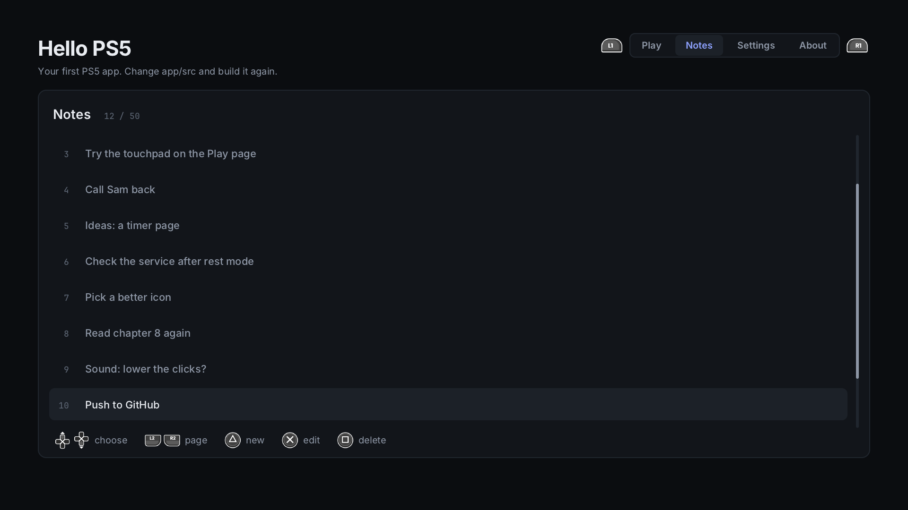

# 8. Lists, pictures, the keyboard and sound

Most apps soon need a few things beyond boxes and text: a list longer than the
screen, a picture, a way to type something, and a little sound. Hello PS5 has
all four. The **Notes** page is a list you write with the PS5's on-screen
keyboard, every page shows its buttons as controller icons, and every page
clicks and chirps as you use it.



| File | What's in it |
| --- | --- |
| [`page_notes.cpp`](../app/src/page_notes.cpp) | the Notes page: a list that scrolls, saved in `/data` |
| [`keyboard.hpp`](../app/src/keyboard.hpp), [`keyboard.cpp`](../app/src/keyboard.cpp) | the PS5's on-screen keyboard |
| [`image.hpp`](../app/src/image.hpp), [`image.cpp`](../app/src/image.cpp) | pictures: PNG and JPEG, with [stb_image](https://github.com/nothings/stb) |
| [`buttons.hpp`](../app/src/buttons.hpp), [`buttons.cpp`](../app/src/buttons.cpp) | controller button icons, and the hint lines made of them |
| [`sound.hpp`](../app/src/sound.hpp), [`sound.cpp`](../app/src/sound.cpp) | sound effects, made in code |
| [`app/stubs/common_dialog.c`](../app/stubs/common_dialog.c) | a stub the keyboard needs (see *A function the SDK doesn't have*) |

On the Notes page: **Triangle** writes a new note, **Cross** edits the chosen
one, **Square** deletes it (press it twice), **L2** and **R2** jump a page.

## A list that scrolls

The notes are an array of strings, saved one per line in
`/data/ps5-starter/notes.txt`. Two numbers turn them into a list on screen:

```cpp
int notes_selected; // the highlighted row
int notes_first;    // the first row in view
```

Up and Down change `notes_selected`. Then `keep_in_view()` moves the first row
only as far as it has to, so the list scrolls when the highlight reaches an
edge, not on every press:

```cpp
if (s.notes_selected < s.notes_first)
    s.notes_first = s.notes_selected;
if (s.notes_selected >= s.notes_first + rows_in_view)
    s.notes_first = s.notes_selected - rows_in_view + 1;
```

**Smooth scrolling.** The list isn't drawn at `notes_first` directly. A third
number, `notes_scroll`, is the position shown, in pixels. Every frame it moves
a quarter of the way to where it should be, so the list glides instead of
jumping:

```cpp
const float target = static_cast<float>(s.notes_first * row_h);
s.notes_scroll += (target - s.notes_scroll) * 0.25f;
```

`notes_update()` returns true while it's still moving, so the app keeps
drawing until it arrives (chapter 6: only draw when something changed).

**Drawing** starts at the row `notes_scroll` points at, and each row goes where
the scroll puts it. Rows half outside the list are cut off at its edges by a
clip:

```cpp
c.clip(list_x, list_y, list_w, list_h); // nothing is drawn outside this box...
/* the rows */
c.unclip();                             // ...until this
```

**The scrollbar** shows what part of the list you see: the thumb is as long as
the rows in view are a part of all rows, and sits as far down as the scroll is.

**Deleting** takes two presses, the habit from chapter 7. The first press
marks the row red and says *Press Square again to delete*. A second press
within 3 seconds deletes it; moving away or waiting cancels it.

The same code works for any list: swap the strings for your own struct (a
game, a file, a server) and draw its fields in the row.

## Pictures

```cpp
#include "image.hpp"

image::Image logo;
image::load(STARTER_APP0 "/assets/logo.png", logo); // once, at startup
...
c.image(x, y, 200, 200, logo);                      // in draw()
```

- `load()` reads a PNG or JPEG and decodes it with stb_image into the screen's
  own pixel format. It returns false if the file is missing or broken, and
  `logo.loaded()` says the same later.
- `c.image()` draws it at any size, smoothly: shrunk pictures are averaged,
  enlarged ones blended between pixels. A PNG's transparency is kept, and a
  last argument (0 to 255) fades it.
- **Load once, draw often.** Decoding takes a few milliseconds; do it at
  startup or when a page opens, never in `draw()`.
- **Mind the memory:** a picture takes width × height × 4 bytes, so a
  1920 × 1080 background is 8 MB. Keep pictures near the size you draw them.

The About page draws the app's own icon, `STARTER_APP0 "/sce_sys/icon0.png"`
(512 × 512), at 180 pixels.

**Your own pictures go in [`app/assets`](../app/assets).** `app/build.sh` packs
that folder into the app as `/app0/assets`, and the simulator and preview copy
it too. That's where the button icons are.

### Button icons

Every page says what its buttons do with the controller's own symbols:

```cpp
#include "buttons.hpp"

using namespace buttons;
static const Hint what_does_what[] = {
    {dpad_up, dpad_down, "choose"}, {l2, r2, "page"}, {triangle, none, "new"},
};
hints(c, x, y, what_does_what, 3);              // a row of icons and words
buttons::draw(c, buttons::cross, x, y, 40);     // or one icon, 40 pixels
```

The icons are 16 PNGs in [`app/assets/buttons`](../app/assets/buttons),
`buttons::load()` reads them once at startup, and `c.image()` draws them at
whatever size the page asks for. They're from
[PS4 Buttons](https://arks.itch.io/ps4-buttons) by Arks, under
[CC BY 4.0](https://creativecommons.org/licenses/by/4.0/): free to use and
share, as long as you credit Arks and say what you changed (here, resized
from 480 to 96 pixels). `CREDITS.txt` next to them says so, and the About page
credits them too. Keep both if you keep the icons.

If an icon is missing, `buttons::draw()` writes the button's name instead, so
the app still works without them.

## The on-screen keyboard

The PS5's own keyboard opens over the app. Like everything else in the app,
it doesn't wait: `open()` shows it and returns at once, and `poll()`, called
every frame, says how it's going.

```cpp
#include "keyboard.hpp"

// Triangle pressed:
keyboard::open("New note", "Write something", "", keyboard::max_length);

// In update(), every frame:
switch (keyboard::poll()) {
case keyboard::State::open:      break;                    // still typing
case keyboard::State::accepted:  save(keyboard::text());   break;
case keyboard::State::cancelled: break;                    // closed without OK
case keyboard::State::failed:    say("The keyboard couldn't open"); break;
case keyboard::State::idle:      break;                    // nothing open
}
```

`accepted`, `cancelled` and `failed` are each reported once. The Notes page
remembers what the keyboard was opened for in `s.editing`: -1 for a new note,
a note's number to edit it, -2 when it's closed.

- **Text is UTF-8** in the app, like everywhere else. `keyboard.cpp` converts it
  to UTF-16, what the PS5 uses, and back.
- **While it's open, the controller is the keyboard's.** `pad::poll()` returns
  nothing, and `hello.cpp` doesn't switch tabs. When it closes, the button
  that closed it doesn't count as a press in the app, or the Cross that said
  OK would open the keyboard again (`input::suspend()` in `pad_input.cpp`).
- **Where it appears** is a point on the 1920 × 1080 screen plus which part of
  the keyboard goes there: `pos_x`, `pos_y` and the two alignments in
  `keyboard.cpp`. Hello PS5 puts its centre in the middle of the screen.

In the simulator, a text box stands in for it, and your PC's keys type
(chapter 10).

### A function the SDK doesn't have

Before it can open, the keyboard needs `sceCommonDialogInitialize()`, and the
PS5 payload SDK has no stub for it: the build would stop with *undefined
symbol*. Looking it up by name while the app runs doesn't work either: the
console answers `0x80020003`, "not found".

So [`app/stubs/common_dialog.c`](../app/stubs/common_dialog.c) is a **stub**:
a function with the right name and an empty body, which `app/build.sh` builds
as `libSceCommonDialog.so` and hands to the kit:

```bash
prospero-lld --shared -soname libSceCommonDialog.sprx -o libSceCommonDialog.so common_dialog.o
make ... APP_IMPORT_STUBS=starter/stubs/libSceCommonDialog.so
```

The kit only reads the stub's function names and its library name. The body
never runs: when the app starts, the console connects the call to the real
`sceCommonDialogInitialize` in its own `libSceCommonDialog.sprx`. Any other
system function the SDK lacks works the same way: a stub file, built with
`-soname <its library>.sprx`, added to `APP_IMPORT_STUBS`.

## Sound

The sound effects are made in code, so there are no audio files to carry:

```cpp
#include "sound.hpp"

sound::play(sound::Effect::select);
```

| Effect | Sounds like | Used for |
| --- | --- | --- |
| `move` | a short tick | the selection moved, a tab changed |
| `select` | a rising chirp | Cross did something |
| `back` | a falling tone | closed, cancelled, deleted |
| `error` | a low buzz | not possible, or "press again" |

Each effect is a **tone**: a pitch that slides from one value to another, then
fades out. They're in a table at the top of `sound.cpp`, so changing the
sounds means changing numbers:

```cpp
{700, 1400, 75, 0.20f, Wave::sine}, // select: 700 Hz up to 1400 Hz in 75 ms, at 20% volume
```

**How it plays.** Sound is a stream of numbers, 48,000 a second for each ear.
`render()` works them out a batch at a time. On the PS5, a thread hands each
batch of 256 to `sceAudioOutOutput()`, which waits until the previous one has
started playing, so the loop runs exactly as fast as the sound and needs no
timer. In the simulator, SDL asks for batches from its own thread instead.
`play()` only notes which effect to start; the sound thread picks it up within
a few milliseconds.

The **Sound** row on the Settings page turns it all off, with
`sound::enable(false)`. Always give people that choice.

One PS5 catch: **don't name threads.** `pthread_setname_np()` hangs on the
console.

## Good habits

- **Load files once,** at startup or when a page opens, never in `draw()`.
- **Handle cancel.** People close the keyboard without pressing OK; nothing
  should change when they do.
- **Show where you are in a long list:** a count (*12 / 50*) and a scrollbar.
- **Short, quiet sounds,** and a way to turn them off.
- **Check on the console.** The simulator's keyboard is a stand-in: only the
  console shows whether the PS5 accepts a call, like the lookup above.

Next: [App and payload together](09-app-and-payload.md)
